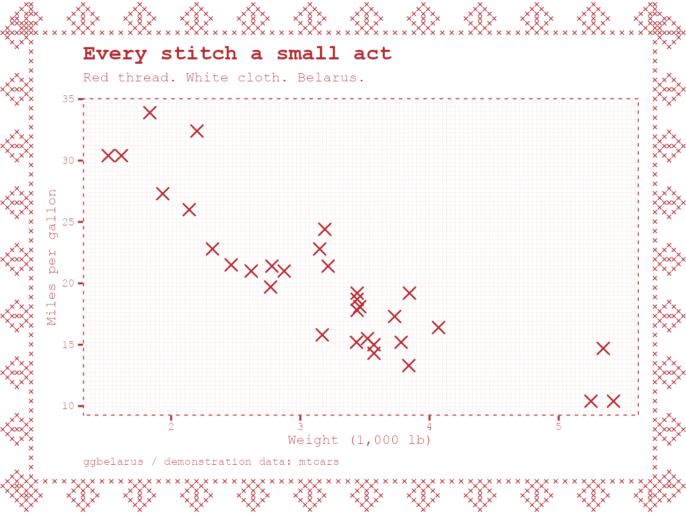
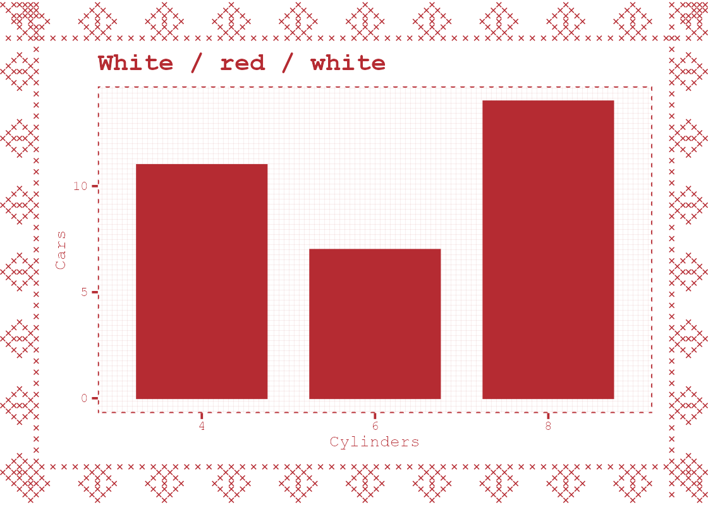
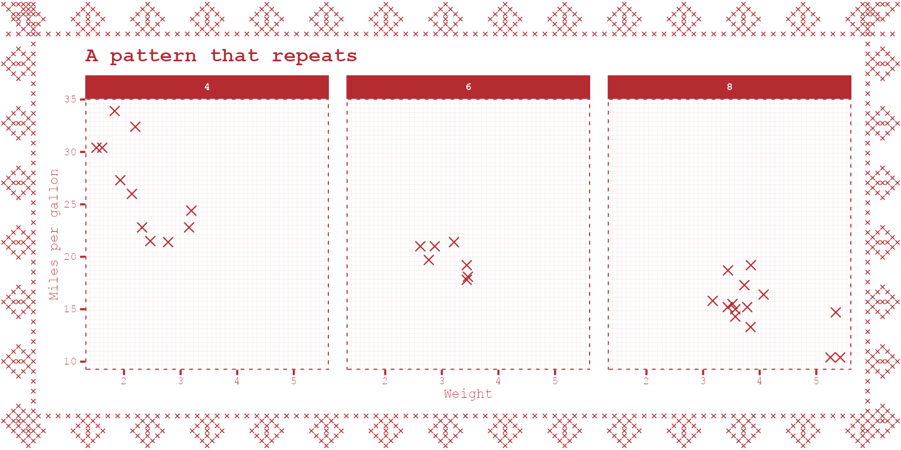

# ggbelarus

Red thread. White cloth. A small act of resistance.

```r
remotes::install_github("hughjonesd/ggbelarus")
library(ggplot2)
library(ggbelarus)

ggplot(mtcars, aes(wt, mpg)) + geom_stitch() + theme_belarus()
```



`theme_belarus(stitch = 1.4)` controls stitch spacing in mm.
Ordinary points default to red squares. `geom_stitch()` draws crosses.
Use ragg PNG, `cairo_pdf`, or `svg`; patterns need a supporting device.
With `ggsave()`, set `bg = "white"`.




Inspired by Belarusian embroidery and Rufina Bazlova's illustrations in
[The Economist](https://www.economist.com/interactive/europe/2026/10/09/belarus-is-becoming-increasingly-russian).
Original geometric motifs; no artwork copied.
